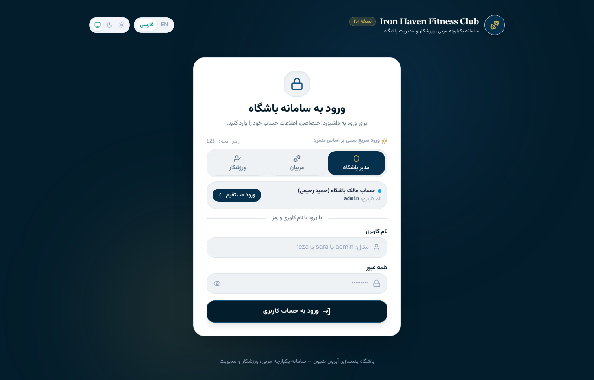
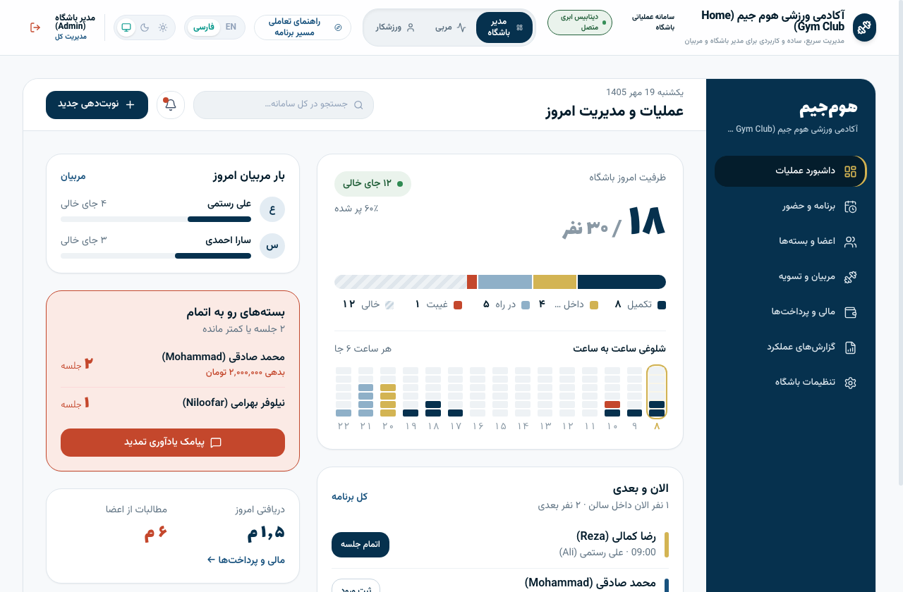
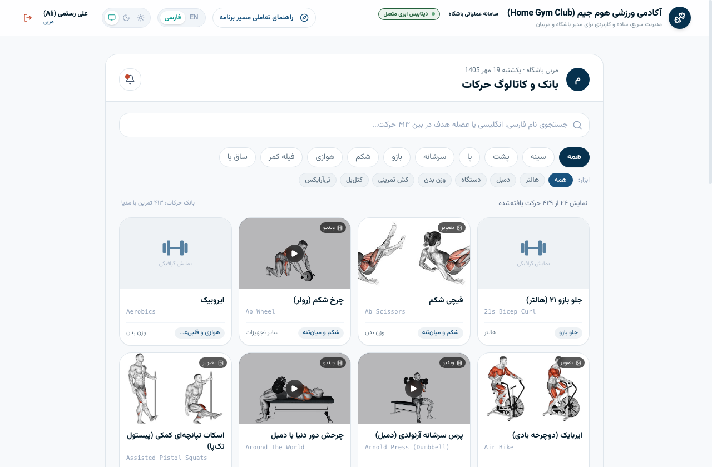
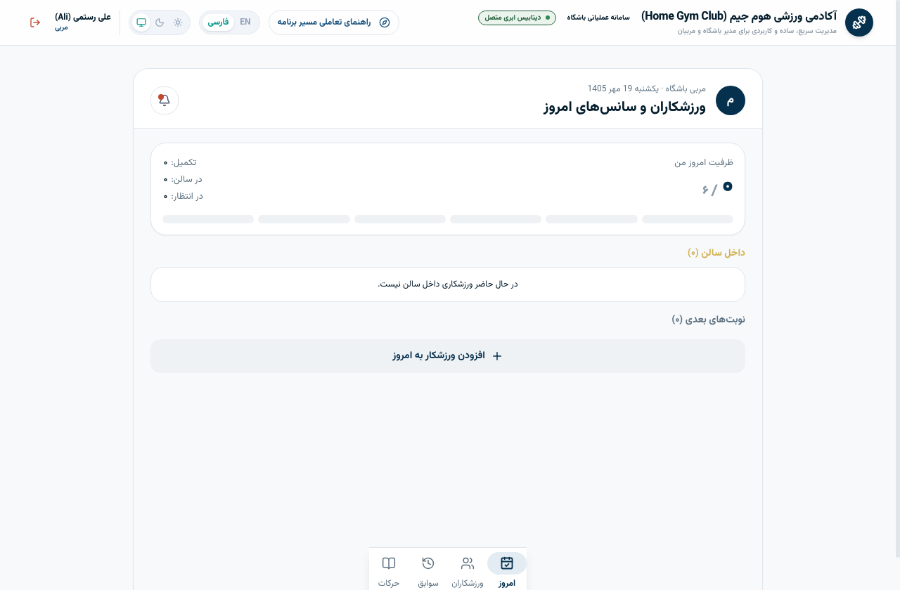
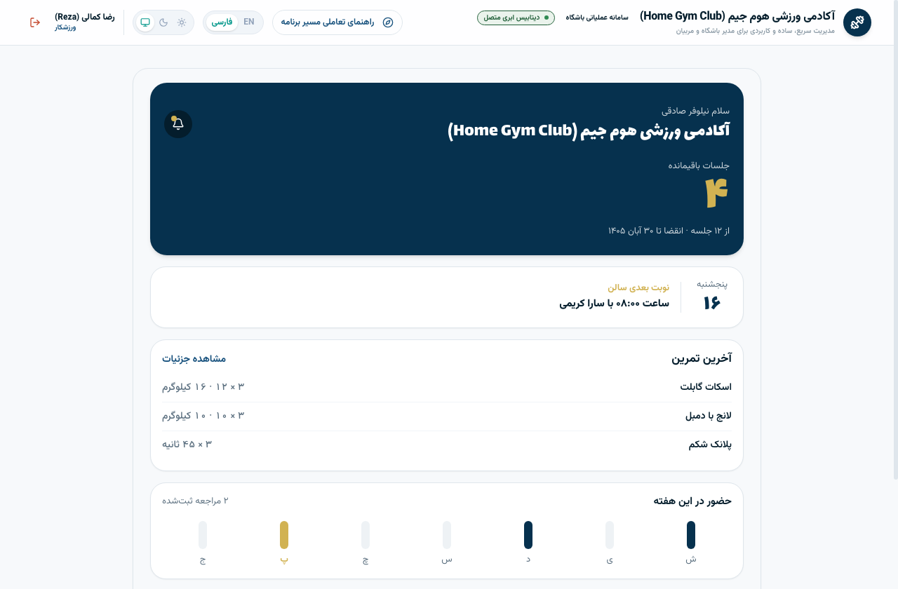
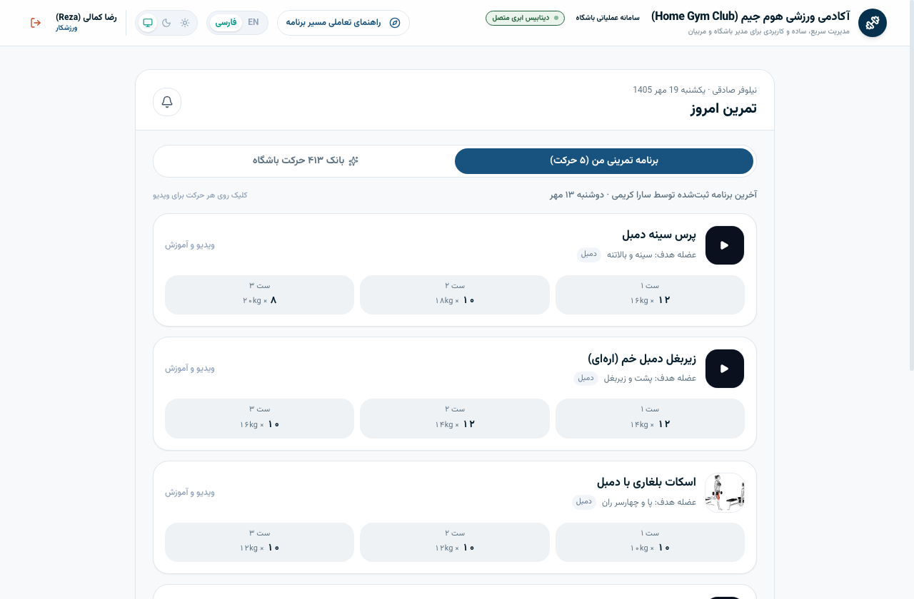

# 🏋️‍♂️ سامانه یکپارچه مدیریت باشگاه ورزشی و هوم‌جیم (Home Gym App)

> **یک پلتفرم مدرن، سریع و اختصاصی (RTL-First) برای مدیریت باشگاه‌های بدنسازی، استودیوهای ورزشی و هوم‌جیم‌های خصوصی.**  
> طراحی‌شده بر مبنای دیزاین سیستم صنعتی **Ink / Steel / Brass / Rubber** با پشتیبانی کامل از تقویم هجری شمسی، تایپوگرافی اصیل ایرانی و بانک جامع **۴۱۳ حرکت ورزشی**.

---

## 📸 پیش‌نمایش محیط برنامه (Screenshots)

### ۱. صفحه ورود مدرن با احراز هویت مبتنی بر نقش (Sign In)
ورود اختصاصی با پیش‌نمایش بصری ۳ سطح دسترسی، دکمه‌های ورود سریع تستی و پالت رنگی هماهنگ با دیزاین سیستم.



---

### ۲. پنل مدیریت کل و مالک باشگاه (Owner Workspace)
داشبورد لحظه‌ای سالن، کنترل ظرفیت ساعتی با نشانگر زنده، هشدار تمدید بسته‌ها، نظارت بر کارکرد مربیان و تراکنش‌های مالی.



---

### ۳. پنل مربی و بانک جامع ۴۱۳ حرکت ورزشی (Trainer Workspace & Catalog)
مدیریت سانس‌های روزانه، هدایت زنده جلسات تمرین، استپرهای ۲.۵ کیلوگرمی و جستجو در بانک حرکات همراه با ویدیو و تصاویر متحرک.

| کاتالوگ ۴۱۳ حرکت ورزشی | داشبورد سانس‌های مربی |
| :---: | :---: |
|  |  |

---

### ۴. پنل اختصاصی ورزشکار و شاگرد (Athlete Workspace)
کارت هیرو وضعیت بسته جلسات، نوبت بعدی سالن، برنامه تمرینی متصل به ویدیوهای آموزشی و نمودار حضور هفتگی.

| داشبورد اصلی شاگرد | برنامه تمرینی و حرکات |
| :---: | :---: |
|  |  |

---

## 👥 شرح کامل ۳ سطح دسترسی و نقش‌های کاربری (User Roles)

این سامانه برای ۳ گروه کاربری مجزا طراحی شده و هر نقش دارای رابط کاربری و امکانات اختصاصی خود می‌باشد:

### 👑 ۱. مدیر و مالک باشگاه (Gym Owner / Admin)
* **داشبورد عملیات زنده (`Dash`):**
  * نمایش ظرفیت روزانه و شلوغی ساعت‌به‌ساعت سالن (۸:۰۰ تا ۲۲:۰۰) با حلقه طلایی نشانگر ساعت جاری.
  * فهرست مراجعین فعال سالن (داخل سالن، در راه، تکمیل‌شده، غایب).
  * هشدار خودکار بسته‌های رو به اتمام (کمتر یا مساوی ۲ جلسه) جهت ارسال پیامک تمدید.
  * خلاصه وضعیت مالی و درآمدهای روزانه.
* **برنامه هفتگی و حضور (`Sched`):**
  * تقویم ۷ روزه هفته بر مبنای تقویم واقعی هجری شمسی و نمایش نوبت‌های رزروشده.
* **مدیریت اعضا و بسته‌ها (`Members`):**
  * فهرست کامل شاگردان، وضعیت بدهی و تسویه، نوار وضعیت جلسات (`Meter`) و کشوی مشخصات (`MemberSheet`).
* **مربیان و دستمزد (`Trainers`):**
  * بررسی بار کاری مربیان، محاسبه دستمزد ناخالص جلسات و ثبت مبالغ واریزی.
* **دفتر مالی (`Finance`):**
  * گزارش کل مطالبات، بدهی‌ها به مربیان، دفتر کل تراکنش‌ها و لیست بدهکاران.
* **گزارش‌های عملکرد (`Reports`):**
  * نمودارهای متحرک حضور هفتگی، تمرینات تکمیل‌شده و بهره‌وری سالن.
* **تنظیمات باشگاه (`Settings`):**
  * تغییر حداکثر ظرفیت سالن، فعال‌سازی قانون غیبت (No-Show)، سوییچ پوسته و حساب‌ها.
* 🔑 **حساب دمو:** نام کاربری `admin` / رمز عبور `123`

---

### 🏋️ ۲. مربیان بدنسازی (Trainers)
* **ورزشکاران و سانس‌های امروز (`Today`):**
  * نمایش ظرفیت کاری اختصاصی مربی (۶ نفر در روز)، وضعیت ورزشکاران داخل سالن و دکمه شروع نوبت.
* **جریان ثبت زنده جلسه تمرین (`SessionFlow`):**
  * فرآیند تمام‌صفحه ثبت ست‌ها، وزنه‌ها (استپر ۲.۵ کیلوگرمی) و تکرارها (استپر ۱ تکراری).
  * دکمه افزودن مستقیم حرکت از بین **۴۱۳ حرکت کاتالوگ**.
  * ثبت اتمیک پایان جلسه همراه با کسر ۱ جلسه از بسته شاگرد.
  * **تاب‌آوری آفلاین (Offline-Resilient):** در صورت قطع اتصال اینترنت در زیرزمین باشگاه، پیش‌نویس جلسه در حافظه محلی ذخیره شده و هیچ داده‌ای از دست نمی‌رود.
* **ورزشکاران من (`Athletes`):**
  * دسترسی سریع به شاگردان تحت‌نظر مربی، مانده جلسات و تاریخچه مراجعات آنها.
* **بانک و کاتالوگ حرکات (`Catalog`):**
  * دسته‌بندی عضلانی (سینه، پشت، پا، سرشانه، بازو، شکم، هوازی، فیله، ساق) + فیلتر تجهیزات (هالتر، دمبل، دستگاه، کش، وزن بدن...).
  * پخش آنلاین ویدیوی تکنیک صحیح، عضلات کمکی و نکات آموزشی.
* 🔑 **حساب‌های دمو:** نام کاربری `sara` یا `ali` / رمز عبور `123`

---

### 🏃 ۳. ورزشکاران و شاگردان (Members / Athletes)
* **داشبورد اصلی (`Home`):**
  * هیرو کارت با شمارنده جلسات باقیمانده و تاریخ انقضای بسته.
  * ویجت انیمیشنی صفحات وزنه (`PlateHero`) متناسب با تعداد جلسات مانده.
  * کارت مشخصات نوبت بعدی در سالن همراه با نام مربی و ساعت سانس.
  * نوار بصری حضور و ثبت تمرین در روزهای هفته جاری (شنبه تا جمعه).
* **جلسات و نوبت‌ها (`Sessions`):**
  * مشاهده سانس‌های آینده با امکان درخواست تغییر یا لغو طبق قانون ۴ ساعت قبل از جلسه.
  * آرشیو جلسات گذرانده‌شده.
* **تمرینات روز (`Exercises`):**
  * ریز ست‌ها، وزنه‌ها و تکرارهای ثبت‌شده توسط مربی در آخرین جلسه.
  * دسترسی مستقیم به بانک ۴۱۳ حرکت باشگاه برای یادگیری نحوه اجرای صحیح حرکات.
* **سوابق و رکوردهای شخصی (`History`):**
  * رکوردهای شخصی وزنه (PRs) با کاپ طلایی و نمودار رشد وزنه در جلسات اخیر.
* 🔑 **حساب دمو:** نام کاربری `reza` / رمز عبور `123`

---

## 📚 بانک جامع ۴۱۳ حرکت ورزشی (Exercise Database)

یکی از قابلیت‌های کلیدی برنامه، یکپارچه‌سازی کامل فایل داده‌های تمرینی با مشخصات زیر است:
* **۴۱۳ حرکت استاندارد بدنسازی و فیتنس** با ترجمه تخصصی فارسی.
* **پوشش کامل گروه‌های عضلانی:** سینه، زیربغل و پشت، سرشانه، چهارسر ران، همسترینگ، سرینی (باسن)، جلو بازو، پشت بازو، ساعد، شکم و میان‌تنه، ساق پا و هوازی.
* **تفکیک بر اساس ابزار:** هالتر، دمبل، سیم‌کش و دستگاه، کش تمرینی، کتل‌بل، تی‌آر‌ایکس، صفحه وزنه و وزن بدن.
* **مدیاهای آموزشی آنلاین:** ۲۲۲ ویدیوی متحرک کوتاه و ۱۳۹ تصویر آناتومیک عضلات درگیر، به همراه توضیحات کامل فرم اجرای حرکت.

---

## 🎨 دیزاین سیستم و معماری فرانت‌اند (Design Tokens)

پالت رنگی برنامه طبق استانداردهای طراحی صنعتی ورزشی پیاده‌سازی شده و از کدهای هگز پراکنده استفاده نمی‌کند:

| متغیر توکن | کد رنگ پیش‌فرض | نقش کاربردی |
|---|---|---|
| `--c-ink` | `#06314e` | رنگ برند اصلی و پس‌زمینه کارت‌های هیرو |
| `--c-deep` | `#041d2c` | پس‌زمینه عمیق سایدبار، تیترهای شاخص و تم شب |
| `--c-steel` | `#18527e` | رنگ اکشن‌ها، دکمه‌های فرعی و نوارهای پیشرفت |
| `--c-brass` | `#d1b252` | رنگ طلایی/برنجی، شاخص جلسات زنده و رکوردهای وزنه |
| `--c-rubber` | `#c4472c` | رنگ اخطار بدهی، غیبت و بسته‌های رو به پایان |

* **فونت‌های محلی خودمیزبان (Self-hosted):** استفاده از فونت‌های فارسی **وزیرمتن (Vazirmatn)** برای متون UI و **لاله‌زار (Lalezar)** برای ارقام برجسته و سربرگ، بدون وابستگی خارجی به Google Fonts (کاملاً مقاوم در برابر اختلالات اینترنت).
* **تقویم و ارقام فارسی:** تمام تاریخ‌ها با الگوریتم دقیق جلالی و اعداد با قلم فارسی (`fa()`) فرمت‌دهی می‌شوند.

---

## 🚀 راهنمای نصب و اجرای محلی (Quick Start)

### پیش‌نیازها
* **Bun:** نسخه ۱٫۴ یا بالاتر (مدیر بسته و اجراکنندهٔ تست‌ها)
* **Node.js:** نسخه ۲۰ یا بالاتر (برای `bun start`)

### مراحل اجرا
```bash
# ۱. کلون کردن ریپازیتوری
git clone https://github.com/Zeus7f/home-gym-app.git
cd home-gym-app

# ۲. نصب وابستگی‌ها
bun install --frozen-lockfile

# ۳. تنظیم متغیرهای محیطی
cp .env.example .env

# ۴. اجرای سرور توسعه (Development Server)
bun run dev
```

برنامه روی آدرس **`http://localhost:3000`** در دسترس خواهد بود.

---

## 🛠️ دستورات پروژه (Available Scripts)

مدیر بسته‌ی پروژه **Bun** است (`bun.lock` مرجع است؛ `package-lock.json` نسازید).

* `bun install --frozen-lockfile`: نصب وابستگی‌ها دقیقاً مطابق lockfile.
* `bun run dev`: اجرای سرور توسعه (Express + Vite middleware) روی `http://localhost:3000`.
* `bun run build`: ساخت bundle کلاینت در `dist/` — همان خروجی‌ای که روی Cloudflare Workers (Static Assets) منتشر می‌شود.
* `bun run lint`: بررسی انواع TypeScript (`tsc --noEmit`).
* `bun run test`: اجرای تست‌های دامنه.
* `bun run deploy`: انتشار `dist/` روی Cloudflare Workers.
* `bun start`: اجرای سرور Node/Express در حالت production. این دستور ابتدا `build:server` را اجرا می‌کند و bundle سرور را در `build/server.cjs` می‌سازد (خارج از `dist/` تا کد سرور هرگز به‌عنوان asset عمومی منتشر نشود)؛ پیش از آن `bun run build` را اجرا کنید تا `dist/` وجود داشته باشد. این مسیر برای استقرار Cloudflare لازم نیست.

---

## 🗄️ معماری داده و اتصال پایگاه داده

سامانه دارای لایه سرویس انتزاعی داده در مسیر `src/api/` است:
1. **حالت آفلاین / MockStore (پیش‌فرض):** برنامه به صورت آماده و بدون نیاز به هیچ دیتابیس خارجی با داده‌های نمونه واقعی، قابلیت ایجاد جلسه، افزودن عضو و تغییر ظرفیت کار می‌کند.
2. **اتصال دیتابیس ابری (Supabase / PostgreSQL):** با تنظیم مقادیر `VITE_SUPABASE_URL` و `VITE_SUPABASE_ANON_KEY` در فایل `.env`، برنامه به صورت خودکار به پایگاه داده ابری متصل می‌گردد. اسکریپت‌های کامل اسکیما و مایگریشن در پوشه `supabase/` قرار دارند.

---

## 📄 مجوز و توسعه‌دهنده

* توسعه و ارتقا: **تیم توسعه هوم‌جیم (Home Gym Platform)**
* مخزن گیت‌هاب: [github.com/Zeus7f/home-gym-app](https://github.com/Zeus7f/home-gym-app)