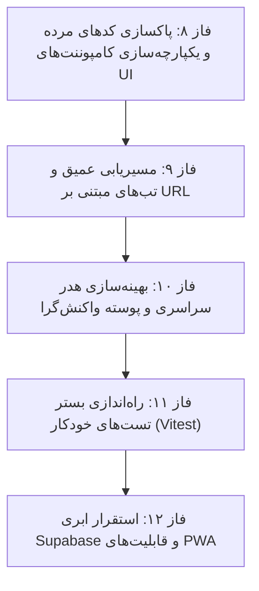

# برنامه اجرایی جامع تکمیل و ارتقای نهایی سامانه HomeGym (فازهای ۸ تا ۱۲)

> **هدف سند:** بررسی جامع وضعیت کنونی سامانه، ارزیابی بدهی‌های فنی و ارائه نقشه راه گام‌به‌گام (Plan) برای تکمیل، پاکسازی، تست و رساندن پروژه به سطح Production-Grade آماده استقرار نهایی.

---

## ۱. ارزیابی وضعیت کلی برنامه (Current System Status)

| بخش | وضعیت فعلی | توضیحات فنی |
|---|---|---|
| **پشته پایه (Core Stack)** | ✅ عالی (Pass) | React 19 + TypeScript + Vite 6 + Tailwind 4 با کامپایل بدون خطا (`npx tsc --noEmit` = ۰ خطا) |
| **دیزاین سیستم و توکن‌ها** | ✅ ۹۰٪ پیاده‌سازی | پالت اختصاصی صنعتی (Ink / Deep / Steel / Brass / Rubber) در `tokens.css`؛ فونت‌های محلی وزیرمتن و لاله‌زار |
| **صفحه ورود (Auth)** | ✅ ۱۰۰٪ مدرن | بازطراحی کامل با پیش‌نمایش ۳ نقشه (مالک، مربی، شاگرد) و دکمه‌های ورود مستقیم تستی |
| **اپلیکیشن مدیر (`/owner`)** | ✅ ماژولار و کامل | ۷ صفحه مجزا (Dash, Sched, Members, Trainers, Finance, Reports, Settings) متصل به `mockStore` |
| **اپلیکیشن مربی (`/trainer`)** | ✅ کامل + آفلاین | صفحات Today, Athletes, History, Catalog؛ هوک `useSessionDraft` با ماندگاری آفلاین در `localStorage` |
| **اپلیکیشن ورزشکار (`/member`)** | ✅ کامل و پویا | صفحات Home, Sessions, Exercises, History؛ ویجت متحرک پشته صفحات وزنه (`PlateHero`) |
| **بانک حرکات ورزشی** | ✅ ۱۰۰٪ یکپارچه | ۴۱۳ حرکت واقعی از `exercises_data.csv`، ترجمه کامل فارسی، مدیاهای آنلاین (ویدیو/تصویر)، فیلتر و جستجو |
| **بیلد نهایی (Production Build)** | ✅ موفق (5.2s) | اجرای موفق `npm run build` با خروجی‌های بهینه‌سازی‌شده و Code-Splitting |

---

## ۲. تحلیل شکاف‌ها و موارد باقیمانده (Gap Analysis)

با وجود تکمیل موفق فازهای ۱ تا ۷، موارد زیر به عنوان بدهی فنی و حوزه‌های نیازمند تکمیل شناسایی شدند:

### شکاف ۱: فایل‌های حجیم و بلااستفاده قدیمی (Dead Code Bloat)
* در پوشه‌های پروژه، فایل‌های تک‌فایلی قدیمی پروتوتایپ هنوز باقی مانده‌اند:
  * `src/features/owner/OwnerWorkspace.tsx` (۱۱۱ کیلوبایت — ۲۲۷۰ خط کد بدون استفاده!)
  * `src/features/trainer/TrainerWorkspace.tsx` (۴۶ کیلوبایت — ۱۰۰۲ خط کد بدون استفاده!)
  * `src/features/member/MemberWorkspace.tsx` (۳۰ کیلوبایت — ۶۲۴ خط کد بدون استفاده!)
  * `src/features/exercises/ExerciseCard.tsx` و `ExerciseEditorModal.tsx` (فقط توسط ورک‌اسپیس‌های قدیمی فراخوانی می‌شدند).
* **نتیجه:** نزدیک به **۲۰۰ کیلوبایت کد مرده** در ریپو وجود دارد که هیچ جا ایمپورت نشده‌اند و نگهداری پروژه را پیچیده می‌کنند.

### شکاف ۲: ته‌مانده استایل‌های سبز/تیلی در کامپوننت‌های کمکی UI
* کامپوننت‌هایی مانند `Button.tsx`, `Badge.tsx`, `Card.tsx`, `Input.tsx` و `UserJourneyGuide.tsx` هنوز دارای کلاس‌های `text-teal-600` یا `bg-teal-500` هستند، در حالی که کامپوننت‌های جدید فاز ۳ (`Btn.tsx`, `Pill.tsx`, `Avatar.tsx`) بر اساس سیستم توکن‌ها ساخته شده‌اند.
* باید این کلاس‌ها اصلاح شده یا کامپوننت‌های موازی یکپارچه شوند.

### شکاف ۳: مسیریابی عمیق با URL (Deep Linking & Sub-routes)
* در حال حاضر در `OwnerShell`، `TrainerShell` و `MemberShell`، تب‌های صفحات از طریق `useState` کنترل می‌شوند و آدرس URL مرورگر با تغییر تب تغییر نمی‌کند.
* **مشکل:** اگر کاربر در تب «مالی» یا «کاتالوگ حرکات» صفحه را رفرش کند، به تب اول برمی‌گردد و دکمه‌های Back/Forward مرورگر بین تب‌ها کار نمی‌کنند.
* **راهکار:** اتصال تب‌ها به ساب‌روت‌های استاندارد `react-router-dom` (مانند `/owner/finance`، `/trainer/catalog`، `/member/exercises`).

### شکاف ۴: بهینه‌سازی هدرها و رفع اشغال مضاعف فضا (Double Header Cleanup)
* در `App.tsx` یک هدر سراسری با ابزار سوئیچ نقش، پروفایل و تم وجود دارد. همزمان در داخل هر Shell نیز یک هدر با تاریخ و عنوان تب قرار گرفته است.
* ترکیب هوشمندانه یا تفکیک وظایف این دو هدر، فضای عمودی را به ویژه در صفحات موبایل بازتر و حرفه‌ای‌تر می‌کند.

### شکاف ۵: نبود تست‌های خودکار (Automated Testing Suite)
* سامانه قوانین محاسباتی و تجاری دقیقی دارد (مانند کسر جلسه، قانون کنسلی ۴ ساعته، هشدار بسته $\le 2$، گام ۲.۵ کیلوگرمی وزنه، تقویم شمسی).
* راه‌اندازی Vitest و نوشتن تست‌های واحد خودکار پایداری برنامه را تضمین خواهد کرد.

### شکاف ۶: قابلیت PWA و حالت نصب‌پذیر موبایل
* با توجه به اینکه این اپلیکیشن روی گوشی مربیان و ورزشکاران در محیط سالن تمرین استفاده می‌شود، افزودن Web App Manifest و متاتگ‌های تمام‌صفحه و Safe-Area موبایل تجربه کاربری را به یک اپلیکیشن بومی نزدیک می‌کند.

---

## ۳. نقشه‌راه اجرایی و فازبندی کارهای باقیمانده (Implementation Plan)

---

### فاز ۸: پاکسازی کدهای مرده و یکپارچه‌سازی کامپوننت‌های UI (Cleanup & Design Polish)
**هدف:** حذف کامل فایل‌های زائد پروتوتایپ قدیمی و ارتقای کامپوننت‌های کمکی به توکن‌های رنگی جدید.

- [ ] **وظیفه ۸.۱:** حذف ایمن فایل‌های منسوخ شده:
  - `src/features/owner/OwnerWorkspace.tsx`
  - `src/features/trainer/TrainerWorkspace.tsx`
  - `src/features/member/MemberWorkspace.tsx`
  - `src/features/exercises/ExerciseCard.tsx`
  - `src/features/exercises/ExerciseEditorModal.tsx`
- [ ] **وظیفه ۸.۲:** ارتقای کامپوننت‌های باقی‌مانده UI در `src/components/ui/`:
  - پاکسازی رنگ‌های هاردکدشده teal/emerald از `Button.tsx`, `Badge.tsx`, `Input.tsx`, `Card.tsx`, `Modal.tsx`.
  - تطابق متغیرهای فوکوس با `--c-steel` و `--c-brass`.
- [ ] **وظیفه ۸.۳:** مدرن‌سازی `UserJourneyGuide.tsx` با تم و توکن‌های سرمه‌ای/استیل/برنجی.
- [ ] **اعتبارسنجی:** اجرای `npx tsc --noEmit` و تایید بیلد بدون خطای ایمپورت.

---

### فاز ۹: مسیریابی عمیق و تب‌های مبتنی بر URL (Sub-Route Deep Linking)
**هدف:** هماهنگی کامل تب‌ها با URLهای مرورگر برای پشتیبانی از بوک‌مارک و تاریخچه مرورگر.

- [ ] **وظیفه ۹.۱: اپلیکیشن مدیر (`/owner`)**
  - تنظیم مسیرهای فرعی:
    - `/owner` → هدایت به `/owner/dash`
    - `/owner/dash` (داشبورد عملیات)
    - `/owner/sched` (برنامه و حضور)
    - `/owner/members` (اعضا و بسته‌ها)
    - `/owner/trainers` (مربیان و تسویه)
    - `/owner/finance` (مالی و پرداخت‌ها)
    - `/owner/reports` (گزارش‌های عملکرد)
    - `/owner/settings` (تنظیمات باشگاه)
  - اتصال سایدبار و نوار موبایل `OwnerShell` به `useLocation` و `useNavigate`.
- [ ] **وظیفه ۹.۲: اپلیکیشن مربی (`/trainer`)**
  - تنظیم مسیرهای فرعی:
    - `/trainer` → هدایت به `/trainer/today`
    - `/trainer/today` (امروز)
    - `/trainer/athletes` (ورزشکاران)
    - `/trainer/history` (سوابق)
    - `/trainer/catalog` (کاتالوگ حرکات)
- [ ] **وظیفه ۹.۳: اپلیکیشن ورزشکار (`/member`)**
  - تنظیم مسیرهای فرعی:
    - `/member` → هدایت به `/member/home`
    - `/member/home` (خانه و بسته جلسات)
    - `/member/sessions` (جلسات من)
    - `/member/exercises` (تمرینات و بانک حرکات)
    - `/member/history` (سوابق و رکوردها)
- [ ] **اعتبارسنجی:** تست کلیک روی تب‌ها، دکمه Back مرورگر و رفرش صفحه روی یک تب مشخص.

---

### فاز ۱۰: بهینه‌سازی هدر سراسری و پوسته واکنش‌گرا (Header & Shell Optimization)
**هدف:** هماهنگ‌سازی هدر سراسری `App.tsx` با هدرهای داخلی صفحات برای ایجاد نهایت ظرافت در چیدمان.

- [ ] **وظیفه ۱۰.۱:** حذف تکرار عنوان و یکپارچه‌سازی تاریخ شمسی بین هدر سراسری و شل‌های داخلی.
- [ ] **وظیفه ۱۰.۲:** بهینه‌سازی ارتفاع در موبایل و اعمال Safe-Area Inset برای دستگاه‌های دارای بریدگی ناچ (`env(safe-area-inset-bottom)`).
- [ ] **وظیفه ۱۰.۳:** بهینه‌سازی رفتار اسکرول بدنه به صورت مستقل (Sticky Tabbar & Scroll Isolation).

---

### فاز ۱۱: راه‌اندازی بستر تست‌های خودکار (Automated Testing Suite)
**هدف:** ایجاد تست‌های واحد (Unit Tests) برای تضمین دقت فرمول‌ها و محاسبات حساس باشگاهی.

- [ ] **وظیفه ۱۱.۱:** نصب و پیکربندی Vitest در `vite.config.ts`.
- [ ] **وظیفه ۱۱.۲:** نوشتن تست‌های توابع فرمت‌دهی و اعداد فارسی (`src/lib/format.test.ts`):
  - تست تابع `fa(num)` با مقادیر صفر، اعشاری و منفی.
  - تست تابع `toman(amount)` و `shortToman(amount)`.
- [ ] **وظیفه ۱۱.۳:** نوشتن تست‌های تقویم شمسی (`src/lib/date/jalali.test.ts`):
  - تست محاسبه ساعات زنده، روزهای هفته جاری شمسی و تبدیل فرمت.
- [ ] **وظیفه ۱۱.۴:** نوشتن تست‌های قوانین تجاری (`src/lib/domain/rules.test.ts`):
  - تست قانون کنسلی ۴ ساعته قبل از جلسه.
  - تست شرط هشدار بسته کمتر یا مساوی ۲ جلسه.
  - تست محاسبه کارکرد و دستمزد ناخالص مربیان.
- [ ] **وظیفه ۱۱.۵:** نوشتن تست‌های جستجو و فیلترهای کاتالوگ ۴۱۳ حرکتی (`src/api/exercises.test.ts`).

---

### فاز ۱۲: تنظیمات دیتابیس ابری و قابلیت PWA (Cloud DB Guide & PWA)
**هدف:** مستندسازی شفاف پیکربندی ابری و افزودن قابلیت نصب برنامه روی گوشی.

- [ ] **وظیفه ۱۲.۱:** ایجاد سند آموزشی جامع `docs/SUPABASE_SETUP.md`:
  - اسکریپت‌های DDL و جداول PostgreSQL برای ایمپورت به Supabase.
  - مستندسازی متغیرهای محیطی `.env.example`.
- [ ] **وظیفه ۱۲.۲:** ایجاد فایل مانیفست وب‌اپلیکیشن `manifest.webmanifest`:
  - نام اپلیکیشن (`HomeGym | هوم‌جیم`).
  - رنگ پس‌زمینه و نوار وضعیت (`#041d2c`).
  - آیکون‌های استاندارد PWA و حالت `display: standalone`.

---

## ۴. اولویت‌بندی و زمان‌بندی پیشنهادی

| اولویت | فاز | مدت زمان تقریبی | اثرگذاری در کیفیت |
|---|---|---|---|
| **۱ (فوری)** | **فاز ۸: پاکسازی کدهای مرده و یکپارچه‌سازی UI** | ۱۵ الی ۲۰ دقیقه | سبک‌سازی ریپو و حذف کامل رنگ‌های متناقض |
| **۲ (مهم)** | **فاز ۹: مسیریابی عمیق با URL (Sub-routes)** | ۲۰ الی ۲۵ دقیقه | تجربه کاربری حرفه‌ای، ذخیره تب فعال و رفرش بدون پرش |
| **۳** | **فاز ۱۰: بهینه‌سازی هدر و پوسته موبایل** | ۱۵ الی ۲۰ دقیقه | زیبایی بصری و بهره‌وری حداکثری از صفحه نمایش |
| **۴** | **فاز ۱۱: راه‌اندازی تست‌های خودکار (Vitest)** | ۲۵ الی ۳۰ دقیقه | اطمینان ۱۰۰٪ از صحت محاسبات مالی و منطق سیستم |
| **۵** | **فاز ۱۲: مستندات Supabase و تنظیمات PWA** | ۱۵ الی ۲۰ دقیقه | آمادگی نهایی برای تحویل و استقرار روی گوشی کاربران |
